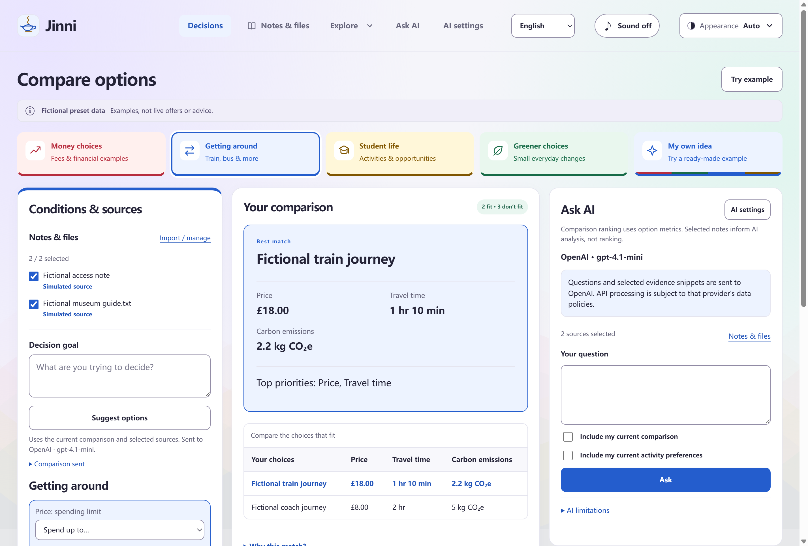

# Jinni

Compare your options using priorities, hard limits and evidence. Jinni shows why a choice fits, what you give up, and which alternatives remain.

Built by **Team39** — **Theo** (backend) and **Wahab** (interface) — for the **DYHTG 2026 BlackRock challenge**. Independent team prototype; not an official BlackRock or Aladdin product.

## What you can do

- Compare **Market, Travel, Student, Sustainability** or **Your own idea** scenarios. Set priorities and limits; inspect results, exclusions and both data sources.
- Import notes, TXT/Markdown or text PDFs into a local library. Select the evidence you want to use.
- On desktop, ask the selected AI provider to explain evidence or **Suggest options** with checked quotations. AI proposals stay separate from calculated scores.
- Use the same three-panel workspace on desktop and in a browser, with light/dark themes and five interface languages. English is the default.



**The calculations are real; the built-in datasets are fictional.** No preset uses live market prices, routes, university listings or environmental feeds. Scores describe preference fit among the supplied options. Imported files inform AI answers and proposals; they do not silently become measurements or change rankings.

## Run on Windows

Install [uv](https://docs.astral.sh/uv/getting-started/installation/) and Node.js **22+** with npm. In the repository root, install dependencies once:

```powershell
uv sync --locked
npm ci
```

Double-click **`start-my-jinni.cmd`**, or run:

```powershell
.\start-my-jinni.cmd
```

The launcher starts local Electron and the Python backend. After setup, it also works when Node/npm are missing from the launch terminal's PATH and can be opened from another directory. It does not change system PATH settings. This is a source-run application; no installer or bundled Python runtime is included.

With Node/npm available, `npm run desktop` starts the same application. For backend-only work:

```powershell
uv run python -m app
```

The API binds to `http://127.0.0.1:8000`; [interactive API docs](http://127.0.0.1:8000/docs) are available while it runs. The desktop reuses a compatible running backend and closes only a backend process it started. See [desktop setup](desktop/README.md) for ports, storage and troubleshooting.

## Browser edition

The browser edition provides the comparison workspace, detailed activity planner, local file library and passage search. It needs no Python service or AI key. Sources stay in this browser's IndexedDB, separately from the desktop SQLite library. Cloud AI and Google ADC are desktop features; browser search returns original excerpts.

Build and serve locally after dependency setup:

```powershell
npm run build:pages
uv run python -m http.server 8080 --directory dist/pages
```

Open [localhost:8080](http://localhost:8080). The repository includes a GitHub Pages workflow; deployment must be enabled and finish successfully before the [hosted edition](https://wahab-linux.github.io/my-jinni/) is available. See [browser setup](docs/BROWSER.md).

## Optional desktop AI

Open **AI settings**, choose a provider and model, then enter that provider's key. OpenAI, DeepSeek, Google Gemini and Anthropic Claude have separate session keys. Google Vertex AI also supports [Application Default Credentials](docs/GOOGLE_ADC_SETUP.md).

The selected recipient is shown before sending. Questions, the explicit decision context and bounded snippets from selected sources go to that provider. Keys stay in trusted desktop session memory and reach the local chat API only through `X-AI-API-Key`; they are not saved in SQLite, settings or Git. Switching provider never shares a key or silently falls back to another provider.

Comparisons and the activity planner work without AI. Citations check source IDs and exact quotations, not the truth of every generated claim. Review proposals and evidence before relying on them. [Provider details](docs/AI_PROVIDERS.md) · [AI option proposals](docs/AI_OPTIONS.md)

## How it works

```text
Shared web interface → browser engine + IndexedDB
                    → Electron IPC → Python API → pure decision engines
                                                → two source adapters
                                                → local SQLite + optional AI
```

Both editions use `web/`; platform differences live in `web/platform.mjs` and `desktop/`. Scenario configuration owns criteria and source capabilities. The comparison core filters hard constraints before deterministic scoring. The retained activity example separately checks budget, outbound arrival and return to the selected origin, using integer pence and timezone-aware times.

The original lamp mark is local SVG. Existing repository, storage, IPC and API identifiers retain **`my-jinni`** for compatibility with saved data.

## Develop and verify

```powershell
uv run ruff check .
uv run ruff format --check .
uv run pytest
npm run lint:desktop
npm run lint:web
npm run test:desktop
npm run test:web
```

Actual Electron and Chromium suites run with `npm run test:e2e` and `npm run test:web:e2e`; Chromium requires `npx playwright install chromium`. Automated provider transports are mocked. Record real-account checks separately from tests and human demo acceptance.

| Read more | |
| --- | --- |
| [Requirements](docs/REQUIREMENTS.md) · [Architecture](docs/ARCHITECTURE.md) | Scope, rules and boundaries |
| [API](docs/API.md) · [General decisions](docs/GENERAL_DECISIONS.md) | Contracts and scoring |
| [Tasks](docs/TASKS.md) · [Backend prompt](docs/prompts/backend.md) · [Interface prompt](docs/prompts/frontend.md) | Ownership and handoffs |
| [Presentation guide](docs/PRESENTATION_GUIDE.md) | Demo and code walkthrough |
| [AI use statement](docs/AI_USAGE_SUBMISSION.md) · [Development log](docs/AI_USAGE.md) | Submission facts and verification history |
