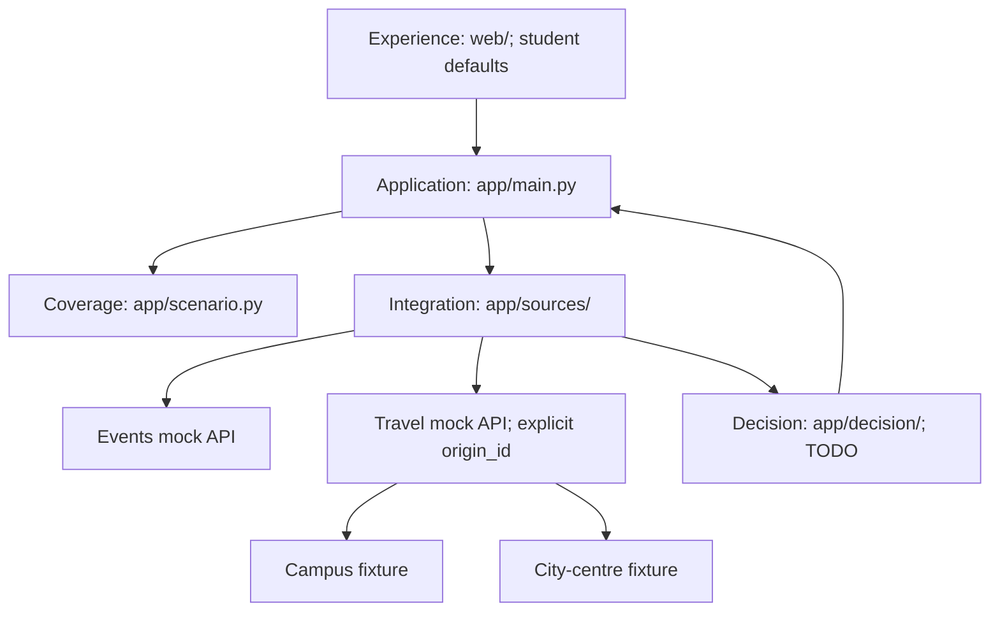

# Activity decisions; students first / 活动决策，学生优先体验

AfterClass helps people choose activities within their budget and available time. Students are the first MVP experience, not an architectural identity requirement. The recommendation engine is **not implemented** and POST still returns 501. This document separates current scaffold from intended implementation.

AfterClass帮助任何人在预算和时间内选择活动；学生是首个MVP体验，不是架构身份要求。推荐引擎**未实现**，POST仍返回501；下文区分已有骨架和待实现边界。

## Responsibilities / 职责

| Boundary / 边界 | Responsibility / 职责 | Exclusions / 排除 |
| --- | --- | --- |
| Experience / 体验 | Forms, origin choices, cost/time display, explanations, UI states. Student defaults are an experience choice. / 表单、起点选择、费用时间、理由、状态；学生默认值是体验选择。 | Hardcoded campus/date or silent fixture fallback. / 写死校园日期或静默回退样例。 |
| Application / 应用 | Routes, configured coverage validation, source orchestration, future engine invocation, error mapping. / 路由、场景范围校验、源调度、引擎调用与错误。 | Ranking inside route handlers. / 在路由中筛选排序。 |
| Activity scenario / 活动场景 | Configure origins/dates/timezone/budget; bind origins to travel feeds. / 配置起点日期时区预算并绑定交通源。 | Student identity gate or city requests using campus travel. / 要求学生身份或混用校园交通。 |
| Decision / 决策 | Normalised preferences/events/journeys in; feasible ranked activities and factual explanations out. / 输入规范化偏好事件交通，输出可行排序与事实理由。 | FastAPI, network/files, campus identity, fixed date, runtime LLM. / 框架网络文件、校园身份、固定日期、运行时LLM。 |
| Integration / 数据接入 | Fetch both shaped feeds, exact Decimal-to-pence conversion, provenance/origin checks, venue joins, source errors. / 两源获取、精确金额转换、来源起点检查、地点关联和异常。 | Missing journey as zero, mixed origin metadata, invented availability. / 缺失按零、起点混用、虚构可用性。 |

The challenge's three layers remain experience, decision, and integration. Application wiring and scenario configuration organise the boundary, not a generic plugin platform or additional runtime service.

题目三层仍为体验、决策和数据接入；应用组装与场景配置只组织边界，不引入通用插件平台或额外服务。

## Existing scaffold / 已有骨架

- `app/schemas.py`: generic structural checks: any nonempty origin slug, nonnegative integer pence, aware ordered timestamps. No campus/date coverage checks.
- `app/scenario.py`: current demo coverage, origin-to-file mapping, and application validation. Campus is the default; city centre is also supported.
- `app/sources/mock_api.py`: event/travel mock feeds. Travel explicitly selects origin-specific data and rejects mismatched origin metadata.
- `data/travel.json` and `data/travel-city-centre.json`: separate fictional durations/fares. The city dataset is not relabelled campus data.
- `app/decision/`: empty. Normalisation, fetching orchestration, feasibility, ranking, explanations, and engine failure tests remain backend tasks.
- `web/fixtures/`: labelled campus examples for parallel frontend work, migrated to `return_at` and origin-aware source metadata.

结构模型不查校园/日期覆盖；场景模块配置范围和独立交通文件；mock源按起点选数据并拒绝不匹配。决策目录仍为空，真正获取、适配、筛选排序、解释和引擎异常测试尚待后端任务实现；前端样例明确是校园示例。

## Activity policy / 活动策略

Require total cost <= budget, arrival <= event start, and event end + return journey <= return deadline. Return is to the **selected origin**. Equality is valid. Rank by interest match descending, total cost ascending, total travel time ascending, event ID ascending. No match is a successful search; required-source failure is an error. This policy operates on supplied dates and journeys, not literal campus/date values.

同时检查预算、准时到达与准时返回**所选起点**，等于边界允许。按兴趣、总价、交通耗时、事件ID排序。无结果为成功搜索，必需源失败为错误；规则使用输入日期和交通，不写死校园或日期。

## MVP limits and future scope / MVP限制与未来范围

This is an activity-selection product, not an arbitrary-domain decision framework. GBP, five categories, return to the same origin, one covered day, fixed travel durations, and simulated data are current scope. New providers require verified adapters and provenance; dates/origins require source coverage; different currencies/taxonomies need an explicit contract decision. No authentication, maps, database, payments, scraping, or runtime LLM is being added. Future extensions are not claimed as delivered.

这是活动选择产品，不是任意领域通用框架。当前范围：英镑、五类活动、返回同一起点、单日覆盖、固定交通耗时、模拟数据。新提供商要验证适配器和来源；新日期起点要有数据覆盖；其他币种分类需协调契约。未来扩展不属于已交付内容，也不增加登录地图数据库支付爬虫或运行时LLM。

## Verification boundary / 验证边界

Scaffold tests check generic noncampus/non-demo-date models, unsupported-scenario 422 responses, city-centre reachability of the explicit 501 stub, origin-specific sources and mismatch rejection, v0.2 fixtures, and OpenAPI consistency. They do **not** establish engine correctness. Budget/time equality, ranking, calculated both-source integration, and source timeouts remain required when the engine is implemented.

骨架测试覆盖通用模型、场景422、合法市中心501、起点隔离和拒绝不匹配、v0.2样例和OpenAPI。它们**不证明引擎正确**；预算时间边界、排序、实际两源推荐与超时测试仍是实现阶段必需项。
