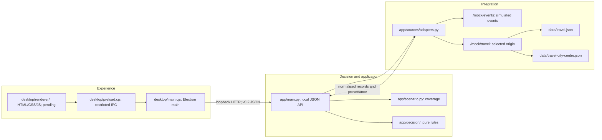

# PlanScope architecture

PlanScope helps people choose an activity within their budget and available time. Students are the first MVP audience; the core does not require student identity. The backend now calculates decisions from both simulated feeds. The product interface is an Electron desktop application, using Wahab's HTML/CSS/JavaScript skills. The desktop implementation, launcher and packaging remain pending.

## Responsibilities

| Boundary | Responsibility | Exclusions |
| --- | --- | --- |
| Desktop renderer | Options-driven controls, cost/time/reasons, visible states, provenance and keyboard/resizing behaviour. Student defaults are configuration. | Decision rules, direct source-file reads, Node access, hardcoded campus/date or automatic fixture fallback. |
| Desktop preload/main | Restricted API-specific IPC bridge, asynchronous loopback requests and owned-backend lifecycle. | Arbitrary IPC channels, arbitrary target URLs or killing unrelated processes. |
| Application | Routes, coverage validation before source calls, adapter/engine orchestration, factual explanations and shared error mapping. | Ranking inside route handlers. |
| Activity scenario | Origins, supported dates, timezone, budget limit and origin-to-source mapping. | Student identity gate or city requests using campus travel. |
| Decision | Immutable normalised preferences, activities and journeys in; ranked feasible candidates, interest-match facts and missing-journey IDs out. | FastAPI, HTTP/files, UI, campus identity, fixed date or runtime LLM. |
| Integration | Fetch independently shaped feeds, validate metadata/records, convert exact GBP text to pence, preserve provenance and check travel origin. | Missing data as zero, mixed origins, invented availability or silently returning partial recommendations after required-source failure. |

These responsibilities fit the challenge's three layers: experience, decision/application and data integration. Scenario configuration is part of the application boundary. The mock feeds are endpoints in the existing backend, not two separately deployed services or independent live organisations. Adapters call them through an injected `httpx.AsyncClient`; default `ASGITransport` reaches the same-process routes without a hardcoded server port.

## Implemented backend

- `app/schemas.py` validates the general v0.2 JSON contract: origin slug, strict nonnegative integer pence, aware ordered timestamps and distinct interests.
- `app/scenario.py` validates current source coverage and budget cap before fetching. Campus and city-centre origins use separate travel datasets.
- `app/sources/mock_api.py` serves fictional data and rejects unknown origins or selected-file origin mismatch.
- `app/sources/adapters.py` fetches both feeds concurrently. Each call has a **two-second** wall-clock deadline, enforced in addition to its HTTP timeout; outstanding sibling tasks are cancelled and awaited after failure. Invalid records can be skipped with warnings when valid records remain; ambiguous or wholly invalid nonempty feeds fail.
- `app/decision/domain.py` defines immutable records. `app/decision/engine.py` joins by venue/destination ID and applies pure feasibility and deterministic ranking. Travel arithmetic and comparisons use UTC instants, including daylight-saving changes.
- `app/main.py` returns one recommendation and up to two alternatives with factual reasons and source metadata. Supported requests no longer return the former 501 scaffold response. Health reports `recommendations_ready: true`.
- `contracts/fixtures/` holds explicitly labelled request/response examples, never fallback answers. `/fixtures/` serves them for development; `/` returns JSON health. `/docs` and `/openapi.json` are developer references.

Run the backend with `uv run python -m app`; it binds to `127.0.0.1:8000`. This command starts no desktop window.

## Desktop implementation and process lifecycle

Wahab owns `desktop/main.cjs`, `desktop/preload.cjs`, `desktop/renderer/` and client tests. The user approved Electron/Tauri and reuse of frontend skills; the selected implementation is Electron. Keep `contextIsolation: true` and `nodeIntegration: false`. Expose a small bridge for options/recommendations through preload; validate IPC input and permitted operations in the trusted main process. The main process calls the local API, so the renderer needs no CORS relaxation or general network/Node capability. HTML/CSS/JavaScript run inside the desktop window; a standalone website is not the deliverable.

Coordinate `package.json`, the Node lockfile and any shared dependency changes. The intended development command is `npm run desktop` **after it is implemented**. No Electron launcher, executable or installer is claimed as delivered by this backend increment.

First integrate the window with a separately started backend. Then add a desktop launcher that starts a backend only if needed, waits for readiness without freezing the UI, and reports startup/port failures clearly. A managed backend must bind to loopback and run without development auto-reload. On close, stop only the backend process the launcher created; leave independently started services untouched. Document and test the command once it exists. Bundling Python with Electron or producing an installer follows a working window and lifecycle and is not delivered yet.

## Activity policy and errors

Require ticket price plus one return fare <= budget, departure plus outbound duration <= event start, and event end plus return duration <= return deadline. The traveller attends the full event and returns to the **selected origin**. Equality is valid. Rank by interest match descending, total cost ascending, total travel duration ascending, then stable event ID ascending. A feasible nonmatching activity remains eligible and receives an honest explanation.

Missing/unavailable journeys exclude affected activities with a warning. Valid empty feeds or no feasible activities return 200 with no recommendation. Required-source failure returns 503; invalid structure, ambiguous IDs, an all-invalid nonempty feed or origin mismatch returns 502. Unsupported input/coverage returns 422 before source calls. No runtime LLM, hidden fixture fallback or fabricated travel is used.

## Limits and verification boundary

GBP, five categories, return to the same origin, one covered demo day, fixed travel estimates and fictional feeds are deliberate MVP limits. New dates/origins require actual source coverage; new providers require adapters and verified provenance. Accounts, maps, databases, payments, scraping, live routing and arbitrary-domain planning remain deferred.

Backend verification on 2026-10-17 passed: **175 tests**, `uv run ruff check .` and `uv run ruff format --check .` across 31 Python files. Tests cover budget/arrival/return boundaries, every ranking priority, source-order stability, missing/unavailable journeys, generic origins/dates, offset/DST arithmetic, independently changed source inputs, malformed/failed feeds and origin consistency. The existing Starlette/httpx TestClient deprecation warning remains.

An actual `uv run python -m app` process started on loopback port 8000 without auto-reload, served health/options and calculated live HTTP requests, then shut down cleanly. Campus budgets 1000/400/0 returned Board Game Night at 500p, Acoustic Hour at 400p and no match respectively; city centre returned Short Film Club at 600p using its own travel. These checks do not establish desktop usability, IPC boundaries, launcher ownership, packaging, human code understanding or demo readiness. Those acceptance steps remain pending until actually performed.
