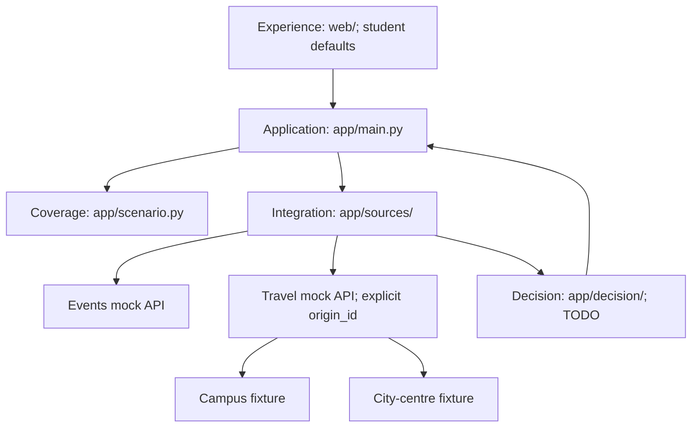

# Activity decisions; students first

AfterClass helps people choose activities within their budget and available time. Students are the first MVP experience, not an architectural identity requirement. The recommendation engine is **not implemented** and POST still returns 501. This document separates current scaffold from intended implementation.

## Responsibilities

| Boundary | Responsibility | Exclusions |
| --- | --- | --- |
| Experience | Forms, origin choices, cost/time display, explanations, UI states. Student defaults are an experience choice. | Hardcoded campus/date or silent fixture fallback. |
| Application | Routes, configured coverage validation, source orchestration, future engine invocation, error mapping. | Ranking inside route handlers. |
| Activity scenario | Configure origins/dates/timezone/budget; bind origins to travel feeds. | Student identity gate or city requests using campus travel. |
| Decision | Normalised preferences/events/journeys in; feasible ranked activities and factual explanations out. | FastAPI, network/files, campus identity, fixed date, runtime LLM. |
| Integration | Fetch both shaped feeds, exact Decimal-to-pence conversion, provenance/origin checks, venue joins, source errors. | Missing journey as zero, mixed origin metadata, invented availability. |

The challenge's three layers remain experience, decision, and integration. Application wiring and scenario configuration organise the boundary, not a generic plugin platform or additional runtime service.

## Existing scaffold

- `app/schemas.py`: generic structural checks: any nonempty origin slug, nonnegative integer pence, aware ordered timestamps. No campus/date coverage checks.
- `app/scenario.py`: current demo coverage, origin-to-file mapping, and application validation. Campus is the default; city centre is also supported.
- `app/sources/mock_api.py`: event/travel mock feeds. Travel explicitly selects origin-specific data and rejects mismatched origin metadata.
- `data/travel.json` and `data/travel-city-centre.json`: separate fictional durations/fares. The city dataset is not relabelled campus data.
- `app/decision/`: empty. Normalisation, fetching orchestration, feasibility, ranking, explanations, and engine failure tests remain backend tasks.
- `web/fixtures/`: labelled campus examples for parallel frontend work, migrated to `return_at` and origin-aware source metadata.

## Activity policy

Require total cost <= budget, arrival <= event start, and event end + return journey <= return deadline. Return is to the **selected origin**. Equality is valid. Rank by interest match descending, total cost ascending, total travel time ascending, event ID ascending. No match is a successful search; required-source failure is an error. This policy operates on supplied dates and journeys, not literal campus/date values.

## MVP limits and future scope

This is an activity-selection product, not an arbitrary-domain decision framework. GBP, five categories, return to the same origin, one covered day, fixed travel durations, and simulated data are current scope. New providers require verified adapters and provenance; dates/origins require source coverage; different currencies/taxonomies need an explicit contract decision. No authentication, maps, database, payments, scraping, or runtime LLM is being added. Future extensions are not claimed as delivered.

## Verification boundary

Scaffold tests check generic noncampus/non-demo-date models, unsupported-scenario 422 responses, city-centre reachability of the explicit 501 stub, origin-specific sources and mismatch rejection, v0.2 fixtures, and OpenAPI consistency. They do **not** establish engine correctness. Budget/time equality, ranking, calculated both-source integration, and source timeouts remain required when the engine is implemented.
