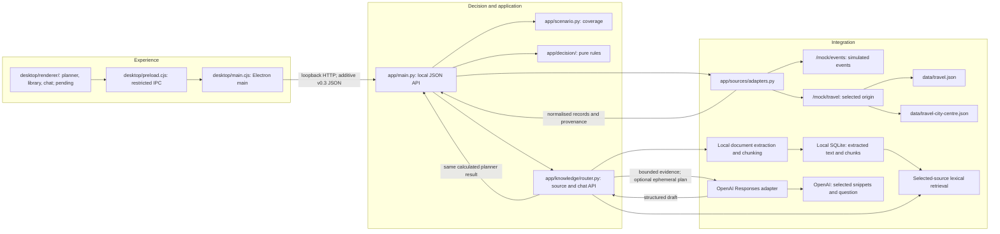

# my-jinni architecture

my-jinni combines a deterministic activity planner with a user-confirmed local source library and optional cited OpenAI questions. Students are the first MVP audience; the activity core does not require student identity. Planning still works without a key. The product interface is an Electron desktop application, using Wahab's HTML/CSS/JavaScript skills. Desktop source/chat integration, session settings, launcher and human acceptance remain pending. Contract v0.3 adds source/chat operations while preserving every v0.2 activity field.

## Responsibilities

| Boundary | Responsibility | Exclusions |
| --- | --- | --- |
| Desktop renderer | Planner controls, source selection/chat, citation viewing, cloud notice, visible states and keyboard/resizing behaviour. Student defaults are configuration. | Decision rules, direct source-file reads, Node access, persistent keys, hardcoded campus/date or automatic fixture fallback. |
| Desktop preload/main | Restricted API-specific IPC, native import picker, session-only key/model settings, asynchronous loopback requests and owned-backend lifecycle. | Arbitrary IPC channels, renderer-supplied paths/target URLs, key persistence or killing unrelated processes. |
| Application | Routes, coverage validation before source calls, adapter/engine orchestration, factual explanations and shared error mapping. | Ranking inside route handlers. |
| Activity scenario | Origins, supported dates, timezone, budget limit and origin-to-source mapping. | Student identity gate or city requests using campus travel. |
| Decision | Immutable normalised preferences, activities and journeys in; ranked feasible candidates, interest-match facts and missing-journey IDs out. | FastAPI, HTTP/files, UI, campus identity, fixed date or runtime LLM. |
| Integration | Fetch independently shaped feeds, validate metadata/records, convert exact GBP text to pence, preserve provenance and check travel origin. | Missing data as zero, mixed origins, invented availability or silently returning partial recommendations after required-source failure. |
| Local knowledge | Bounded text/PDF extraction, page-aware chunks, SQLite persistence/deletion and selected-source lexical retrieval. | Cloud notebooks/sync, original-file archive, OCR, URL fetch, embeddings, stored keys or chat history. |
| AI orchestration | Assemble selected evidence, optionally call the existing planner, request a structured answer and verify citation membership/quotes. | Replacing deterministic rules, inferring/changing form values, claiming quote checks prove truth or executing source instructions. |
| OpenAI adapter | Fixed Responses endpoint, isolated Bearer key, bounded input/output, 30-second deadline and safe provider-error mapping. | Automatic retries/model substitution, remote file/vector-store upload, tools, web browsing or key/body logging. |

These responsibilities fit the challenge's three layers: experience, decision/application and data integration. Scenario configuration is part of the application boundary. The mock feeds are endpoints in the existing backend, not two separately deployed services or independent live organisations. Adapters call them through an injected `httpx.AsyncClient`; default `ASGITransport` reaches the same-process routes without a hardcoded server port.

The source-library extension fits the same layers: the desktop provides selection and questions; application code coordinates retrieval, actual planning and citation checks; local extraction/storage and the OpenAI adapter provide integration. It adds no independently deployed service and no runtime AI dependency to the pure activity engine.

## Implemented backend

- `app/schemas.py` validates the general v0.2 JSON contract: origin slug, strict nonnegative integer pence, aware ordered timestamps and distinct interests.
- `app/scenario.py` validates current source coverage and budget cap before fetching. Campus and city-centre origins use separate travel datasets.
- `app/sources/mock_api.py` serves fictional data and rejects unknown origins or selected-file origin mismatch.
- `app/sources/adapters.py` fetches both feeds concurrently. Each call has a **two-second** wall-clock deadline, enforced in addition to its HTTP timeout; outstanding sibling tasks are cancelled and awaited after failure. Invalid records can be skipped with warnings when valid records remain; ambiguous or wholly invalid nonempty feeds fail.
- `app/decision/domain.py` defines immutable records. `app/decision/engine.py` joins by venue/destination ID and applies pure feasibility and deterministic ranking. Travel arithmetic and comparisons use UTC instants, including daylight-saving changes.
- `app/main.py` returns one recommendation and up to two alternatives with factual reasons and source metadata. Supported requests no longer return the former 501 scaffold response. Health reports `recommendations_ready: true`.
- `contracts/fixtures/` holds explicitly labelled request/response examples, never fallback answers. `/fixtures/` serves them for development; `/` returns JSON health. `/docs` and `/openapi.json` are developer references.

Run the backend with `uv run python -m app`; it binds to `127.0.0.1:8000`. This command starts no desktop window.

## Local library and cited-answer flow

The user approved this additive feature on 2026-10-17. `docs/AI_EXTENSION.md` defines its contract and privacy boundary; `app/knowledge/schemas.py` defines source/chat models. The backend is implemented on `backend-ai-library`; coordinating lint/format and 344 tests passed, including the original planner regression and mocked library/AI checks. Desktop and real-provider acceptance remain separate.

1. A pasted text source or native-picked UTF-8 TXT/Markdown/text PDF reaches the source API. Bounded extraction produces original text and chunks with source identity and one-based PDF page numbers. Filenames are metadata, not server paths. Limits are 5 MiB, 150,000 extracted characters, 40 PDF pages and 20 sources.
2. Local SQLite outside the checkout stores metadata, extracted text and chunks. Optional import `is_simulated` metadata follows the source into evidence/citations; mark fictional/generated demo guides explicitly, while the default false flag does not certify truth. Source detail returns the extracted original text for citation viewing; original file bytes are not retained. Deleting a source removes its chunks and retrieval entries. Keys and chat history are not saved in this database.
3. A question explicitly names selected source IDs. Local lexical retrieval searches only those sources and supplies at most six bounded chunks. It can miss paraphrases or cross-language matches; this is not vector/semantic retrieval.
4. If current form preferences are explicitly provided, chat calls the existing recommendation endpoint and returns its exact calculated JSON in `planner`. It reserves one evidence slot for a simulated ephemeral `planner-context` chunk and does not save that chunk to the library. Planner validation/source errors propagate. Question text never infers or changes the form.
5. No retrieved evidence returns normal `insufficient_evidence` without a model call or key. Otherwise, the selected question/evidence go to the fixed OpenAI Responses endpoint, using the session header key. The request uses Structured Outputs, `store: false`, no tools, a 30-second deadline and bounded output. No provider retry or model substitution occurs automatically.
6. The server accepts a supported answer only with citations whose chunk IDs belong to this request and whose quotes exist verbatim in those chunks. It attaches trusted source/page metadata and preserves simulation labels. Invalid, incomplete or refused output fails safely. These checks establish citation membership, not semantic entailment or factual truth; the user can open evidence and review the claim.

Documents and titles remain untrusted input. Instructions embedded in them are supplied as data and do not authorise actions. An AI explanation must preserve the planner's computed feasibility, costs, times and ranking; the returned planner JSON is the authoritative display.

`gpt-4.1-mini` is the configured default, with a selectable compatible model the user's API account can access. Compatibility and access for an actual account are not established by mocked tests. The OpenAI adapter and source API have separate error paths from activity feeds: authentication, rate limits, unsupported request/model, unavailable provider, timeout and invalid/refused answer remain distinguishable.

## Desktop implementation and process lifecycle

Wahab owns `desktop/main.cjs`, `desktop/preload.cjs`, `desktop/renderer/` and client tests. The selected implementation is Electron. Keep `contextIsolation: true` and `nodeIntegration: false`. Expose narrow methods for options/recommendations, source list/import/view/delete, chat and session-key settings; validate IPC inputs and permitted operations in the trusted main process. Source upload starts in a native file picker; never accept arbitrary renderer filesystem paths. The main process calls the local API, so the renderer needs no CORS relaxation or general network/Node capability. HTML/CSS/JavaScript run inside the desktop window; a standalone website is not the deliverable.

Keep the OpenAI key in main-process session memory and add `X-OpenAI-API-Key` only to chat requests over loopback; never include it in the JSON body or persist it in renderer localStorage, settings, SQLite, repository or logs. Disclose before generation that questions and selected snippets leave the device. `store: false` concerns Responses object storage and is not a blanket provider-retention guarantee. The planner and local library remain usable without an AI key.

Coordinate `package.json`, the Node lockfile and any shared dependency changes. The intended development command is `npm run desktop` **after it is implemented**. No Electron launcher, executable or installer is claimed as delivered by this backend increment.

First integrate the window with a separately started backend. Then add a desktop launcher that starts a backend only if needed, waits for readiness without freezing the UI, and reports startup/port failures clearly. A managed backend must bind to loopback and run without development auto-reload. On close, stop only the backend process the launcher created; leave independently started services untouched. Document and test the command once it exists. Bundling Python with Electron or producing an installer follows a working window and lifecycle and is not delivered yet.

## Activity policy and errors

Require ticket price plus one return fare <= budget, departure plus outbound duration <= event start, and event end plus return duration <= return deadline. The traveller attends the full event and returns to the **selected origin**. Equality is valid. Rank by interest match descending, total cost ascending, total travel duration ascending, then stable event ID ascending. A feasible nonmatching activity remains eligible and receives an honest explanation.

Missing/unavailable journeys exclude affected activities with a warning. Valid empty feeds or no feasible activities return 200 with no recommendation. Required-source failure returns 503; invalid structure, ambiguous IDs, an all-invalid nonempty feed or origin mismatch returns 502. Unsupported input/coverage returns 422 before source calls. The planner uses no runtime LLM, hidden fixture fallback or fabricated travel. Optional AI questions do not weaken these rules.

## Limits and verification boundary

GBP, five categories, return to the same origin, one covered demo day, fixed travel estimates and fictional feeds are deliberate planner limits. New dates/origins require actual source coverage; new activity/travel providers require adapters and verified provenance. One local SQLite library and optional cited OpenAI questions are approved additions. Accounts, maps, payments, scraping, live routing, cloud notebooks/sync, OCR, URL ingestion, embeddings and arbitrary-domain planning remain deferred.

The earlier planner baseline on 2026-10-17 passed **175 tests**, Ruff lint and formatting across its then-current 31 Python files. Tests cover budget/arrival/return boundaries, every ranking priority, source-order stability, missing/unavailable journeys, generic origins/dates, offset/DST arithmetic, independently changed source inputs, malformed/failed feeds and origin consistency. After the extension, the coordinating full run passed **344 tests**, `uv run ruff check .` and `uv run ruff format --check .` across 42 Python files. The existing Starlette/httpx TestClient deprecation warning remains.

An actual `uv run python -m app` process started on loopback port 8000 without auto-reload, served health/options and calculated live HTTP requests, then shut down cleanly. Campus budgets 1000/400/0 returned Board Game Night at 500p, Acoustic Hour at 400p and no match respectively; city centre returned Short Film Club at 600p using its own travel. These checks do not establish desktop usability, IPC boundaries, launcher ownership, packaging, human code understanding or demo readiness. Those acceptance steps remain pending until actually performed.

Library/AI tests use temporary local databases and injected provider transports to cover imports, restart/delete, selected-source isolation, exact citation rejection, planner-context equality and provider failures without real keys or Internet calls. The 344 total comprises 175 planner regressions, 62 storage/ingestion tests, 67 provider tests, 37 knowledge-API tests and three contract-example tests. Live OpenAI success, real account/model access, answer quality and desktop source/chat/session behaviour remain pending human checks. Mocks cannot establish those outcomes.
