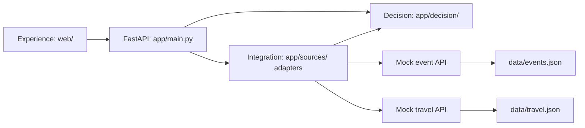

# AfterClass project plan / 项目计划

## Product / 产品

User story: I leave Glasgow's main campus after class, have a budget and interests, and need to return by a deadline. Recommend one feasible activity and explain the cost, travel, and interest match.

用户故事：我从格大主校区出发，有预算和兴趣，必须在指定时间前返校。推荐一个可行活动，说明费用、交通和兴趣匹配情况。

The prototype covers one fixed demo day (2026-10-20), one origin/return point, eight fictional activities, and four fictional travel destinations. Fixed travel durations are estimates, not scheduled buses or a route planner. Both source feeds are independently shaped mock APIs served by this repository, which the challenge permits. They do not claim to be external live providers.

原型只覆盖固定演示日期 2026-10-20、一个出发/返回点、8 个虚构活动和 4 个虚构交通目的地。交通耗时是模拟估计，不是公交时刻表。两源为本项目自建、结构不同的 mock API，符合题目允许的形式，不冒充外部实时服务。

## Decision rules / 推荐规则

1. Fetch both event and travel feeds. Normalise times to aware datetimes and event ticket prices from GBP decimal strings to integer pence using `Decimal`, never binary float.
2. Join `event.venue.id` to `journey.destination_id`. Skip an event with no available journey; do not treat missing cost/time as zero.
3. Reject malformed records with a warning if safe records remain. Invalid feed structure, duplicate IDs causing ambiguous joins, or a feed with no valid records is a 502 `INVALID_SOURCE_DATA`. A structurally valid empty event list is a successful no-match search. An empty travel list means no events have usable journeys.
4. A candidate is feasible only when all three conditions hold:
   - `ticket_cost_pence + return_fare_pence <= budget_pence`
   - `depart_at + outbound_minutes <= event.starts_at`
   - `event.ends_at + return_minutes <= return_by`
5. Rank by `(interest_match descending, total_cost_pence ascending, total_travel_minutes ascending, event_id ascending)`. All listed interests have equal priority. A non-matching interest may still be a feasible alternative.
6. Return the first item as `recommended` and the next zero to two as `alternatives`. No matches is HTTP 200 with `recommended: null` and an empty alternatives list.
7. Generate short explanations directly from these facts. No LLM is needed at runtime.
8. If a required feed times out/fails, return HTTP 503 `SOURCE_UNAVAILABLE`. Do not silently invent travel data or substitute the fixed frontend fixture.

1. 读取两源，使用带时区时间；门票英镑字符串用 `Decimal` 转成整数便士。
2. 按地点 ID 关联；缺失或不可用交通不能按免费、零分钟处理。
3. 可安全跳过的坏记录附带警告；整源结构错误、重复 ID 导致歧义、或整源全是坏记录返回 502。合法空列表按无匹配处理。
4. 同时满足预算、赶上开始、按时返校；等于边界视为满足。
5. 排序：匹配兴趣优先，然后总价更低、往返耗时更短、活动 ID 排序。所选兴趣优先级相同。
6. 一个首选、最多两个备选；没有结果返回 200，首选为 null。
7. 解释由规则直接生成，运行时不依赖 LLM。
8. 必需数据源失败或超时返回 503，不用假结果替代。

## Architecture / 架构

Keep the decision engine pure: normalised data and preferences in, ranked results out. It must not import FastAPI, call HTTP, read files, or know about HTML. Application wiring can inject an `httpx.AsyncClient`; same-process mock HTTP calls can use `httpx.ASGITransport` to avoid a hardcoded port. Test clients can replace that transport to simulate timeouts and malformed responses.

推荐引擎保持纯逻辑：输入规范化数据和偏好，输出排序结果；不导入 FastAPI、不访问 HTTP/文件、不涉及 HTML。应用层可注入 `httpx.AsyncClient`；同进程 mock HTTP 可用 `ASGITransport`，测试替换 transport 来模拟失败。

## Ownership / 文件归属

| Owner / 负责人 | Files / 文件 | Delivery / 交付 |
| --- | --- | --- |
| Backend owner / 你 | `app/`, `data/`, `tests/`, `scripts/` | Fetching, adapters, validation, ranking, API, tests / 接入、适配、推荐、接口、测试 |
| Wahab | `web/index.html`, `web/styles.css`, new `web/*.js` and assets | Accessible responsive UI and all request states / 可访问、响应式前端与请求状态 |
| Shared, coordinate first / 共享，先同步 | `app/schemas.py`, `web/fixtures/`, `docs/API.md`, `docs/openapi.json`, dependencies | Stable contract / 稳定契约 |
| Each person / 各自 | `docs/AI_USAGE.md` (coordinate edits) | Accurate tool, decision, edit, verification records / 如实记录工具、决策、修改与验证 |

Suggested Git branches: backend work on `backend`, Wahab's UI on `frontend`. Commit small coherent changes; merge after the first complete flow. These branches are suggestions, not pre-created checkouts.

建议后端使用 `backend` 分支、前端使用 `frontend` 分支，按小任务提交，首个完整流程后合并；初始化不会预先切换或创建这两个工作分支。

## First integration / 第一次联调

- First 20 minutes: both read and accept the API contract, test the default request, and agree file ownership.
- Next 60–90 minutes: Wahab works against the explicit response fixtures; backend owner implements source integration and the engine. Then wire the live POST request and check the default result.
- Default request should select `event-board-games` for £5 total; lowering budget to 400 pence selects `event-music`; budget 0 yields no match for the default window. Raising budget to 2000 and selecting only `learning` still ranks feasible events by the documented tie-breakers.
- Before finishing Saturday: full flow, key tests, clear limitations, and first demo rehearsal.
- Suggested Sunday 10:30: fixes, documentation, final report, demo practice. Official code freeze is Sunday 12:00 UK time.

前 20 分钟确认契约；随后 60–90 分钟分头开发并联调。默认请求应选桌游，总价 £5；预算降为 £4 时选音乐；默认时间窗预算为 £0 时无结果。周六结束前跑通并演练；建议周日 10:30 起集中修错和文档，官方周日 12:00 停码。

## Acceptance checklist / 验收

- [ ] Recommendation actually combines both sources and changes with preferences.
- [ ] Three code layers remain separate; readable code passes lint.
- [ ] Unit tests cover budget equality, arrival equality, return equality, interest ranking, no match, and invalid/missing records.
- [ ] Integration tests exercise both HTTP sources and source failure.
- [ ] UI supports loading, success, no result, source failure, validation failure, and initial 501.
- [ ] Simulated data is visible; money and time are formatted clearly; labels and keyboard navigation work.
- [ ] One command starts the application; README, architecture, trade-offs, and actual AI usage are complete.

验收包含两源实际参与决策、三层结构、边界和集成测试、完整界面状态、模拟数据标注、可访问性、一条命令启动及最终文档。初始化阶段不勾选尚未完成项。

Trade-offs: mock data gives reproducibility and no external credentials, but does not validate real transport availability. Fixed-day/single-origin scope keeps the demo small. Deterministic ranking is explainable but only reflects the stated preferences and simplified travel estimates.

取舍：mock 数据可重复且无需凭据，但无法证明真实交通可用；固定日期和起点控制范围；确定性排序容易解释，但只反映显式偏好和简化交通估计。
